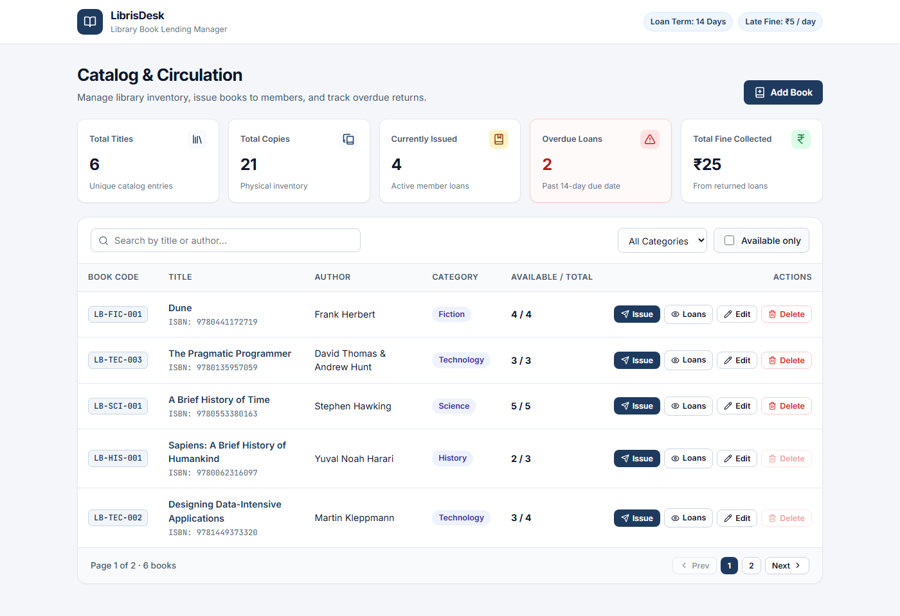
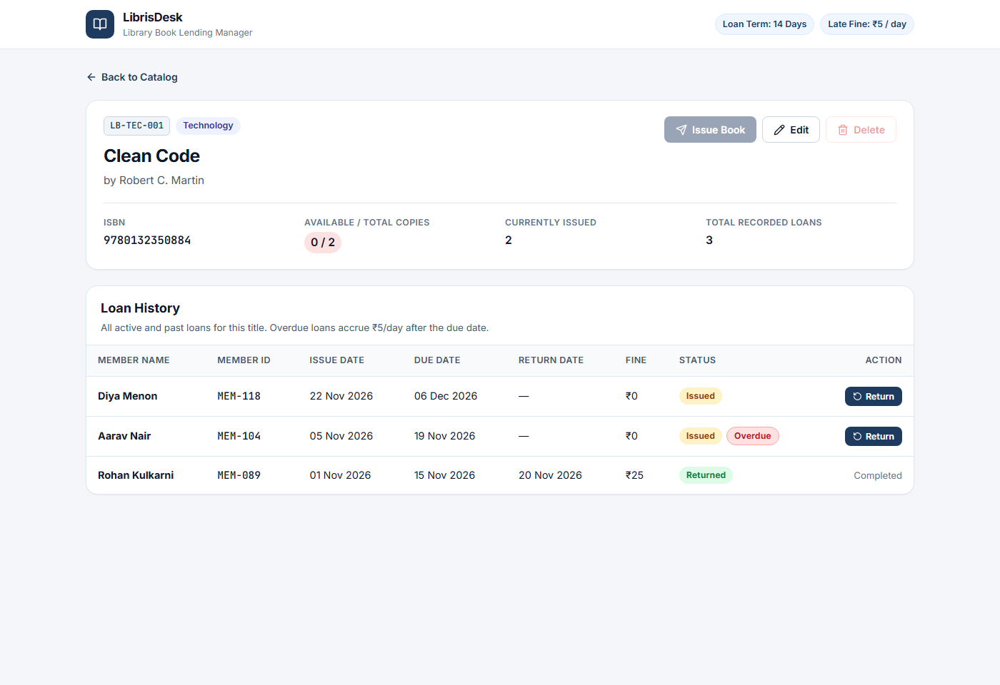

# Library Book Lending Manager (MERN Stack)

A full-stack **Library Book Lending Manager** web application built with **MongoDB Atlas, Express.js, React.js, and Node.js**. Librarians can manage the book catalog, auto-generate category-based book codes, issue copies to members with automatic 14-day due dates, process returns with ₹5/day late fine calculation, inspect per-book loan history with overdue detection, and view real-time library statistics.

---

## Project Structure

```text
library-book-lending-manager/
├── backend/
│   ├── src/
│   │   ├── config/db.js
│   │   ├── controllers/
│   │   ├── models/
│   │   ├── routes/
│   │   ├── utils/
│   │   ├── app.js
│   │   └── server.js
│   ├── tests/api.test.js
│   ├── .env
│   └── package.json
├── frontend/
│   ├── src/
│   │   ├── api/libraryApi.js
│   │   ├── components/
│   │   ├── pages/
│   │   ├── utils/formatters.js
│   │   ├── App.jsx
│   │   ├── index.css
│   │   └── main.jsx
│   ├── .env
│   ├── index.html
│   ├── package.json
│   └── vite.config.js
├── screenshots/
│   ├── dashboard.png
│   └── loan-history.png
├── .gitignore
└── README.md
```

---

## Key Features & Business Rules

- **Add Book**: Validates Title, Author, 10- or 13-digit ISBN, Category (`Fiction`, `Science`, `History`, `Technology`, `Biography`, `Other`), and Total Copies (`1–20`) on both frontend and backend. Rejects duplicate ISBNs with HTTP `409`.
- **Auto-Generated Book Code**: Server generates `LB-<CAT>-<SEQ>` (e.g., `LB-TEC-001`, `LB-FIC-001`) with an independent per-category sequence stored in MongoDB. Clients cannot override it.
- **View, Filter, Search & Paginate**: Filter by category and `Available only`, search by title or author, and paginate 5 books per page via backend query parameters. Out-of-stock copies (`0 / N`) are highlighted in red.
- **Edit Book**: Allows updating Title, Author, and Total Copies through a pre-filled form while locking Book Code, ISBN, and Category. Prevents reducing Total Copies below currently issued copies and recalculates `availableCopies` on the backend.
- **Delete Guard**: Prevents deleting any book with unreturned copies (button disabled in UI and rejected with HTTP `400` on backend) with a confirmation dialog before deletion.
- **Issue & Return Workflow**:
  - Issue Date defaults to today and cannot be a future date.
  - Due Date is automatically set to **14 days** after Issue Date.
  - Prevents issuing when `availableCopies === 0` (`400`) or when the same Member ID already holds an unreturned copy of that book (`409`).
  - Returning a loan sets `returnDate` to today, increments `availableCopies`, calculates a fine of **₹5 per day** after the Due Date (`₹0` if on time), and blocks duplicate returns (`400`).
- **Loan History & Overdue Detection**: Book details page lists all loans with `Issued` / `Returned` badges and a red `Overdue` badge whenever `isOverdue: true` is returned by the backend.
- **Live Statistics**: Backend aggregates Total Titles, Total Copies, Currently Issued Copies, Overdue Loans, and Total Fine Collected, refreshing after every mutation.

---

## API Reference

All endpoints return a consistent JSON envelope:

```json
{
  "success": true,
  "message": "Descriptive status message",
  "data": {}
}
```

### Health

| Method | Endpoint | Description | Status Codes |
| :--- | :--- | :--- | :--- |
| `GET` | `/api/health` | Check API server status | `200` |

### Books

| Method | Endpoint | Description | Query / Body Parameters | Status Codes |
| :--- | :--- | :--- | :--- | :--- |
| `GET` | `/api/books` | List books with filtering, search, and pagination (5/page default) | Query: `category`, `availableOnly` (`true`), `search`, `page`, `limit` | `200`, `400` |
| `POST` | `/api/books` | Add a new book and auto-generate `bookCode` | Body: `{ title, author, isbn, category, totalCopies }` | `201`, `400`, `409` |
| `GET` | `/api/books/:id` | Fetch a single book by ID | Path: `id` | `200`, `400`, `404` |
| `PUT` | `/api/books/:id` | Update `title`, `author`, and `totalCopies` (`bookCode`, `isbn`, `category` immutable) | Path: `id`, Body: `{ title, author, totalCopies }` | `200`, `400`, `404` |
| `DELETE` | `/api/books/:id` | Delete a book (blocked if any copies are currently issued) | Path: `id` | `200`, `400`, `404` |

### Loans

| Method | Endpoint | Description | Query / Body Parameters | Status Codes |
| :--- | :--- | :--- | :--- | :--- |
| `POST` | `/api/books/:id/issue` | Issue a copy to a member with automatic 14-day due date | Path: `id`, Body: `{ memberName, memberId, issueDate }` | `201`, `400`, `404`, `409` |
| `GET` | `/api/books/:id/loans` | Fetch loan history for a book with computed `isOverdue` flag | Path: `id` | `200`, `400`, `404` |
| `POST` / `PATCH` | `/api/loans/:loanId/return` | Return an active loan, restore copy count, and compute late fine (₹5/day) | Path: `loanId` | `200`, `400`, `404` |

### Statistics

| Method | Endpoint | Description | Status Codes |
| :--- | :--- | :--- | :--- |
| `GET` | `/api/stats` | Returns `totalTitles`, `totalCopies`, `issuedCopies`, `overdueLoans`, and `totalFineCollected` | `200` |

---

## Screenshots

### 1. Catalog Dashboard & Live Statistics


### 2. Book Details, Overdue Detection & Loan History


---

## Local Setup & Running

### Prerequisites
- Node.js (v18+ recommended)
- MongoDB Atlas connection string configured in `backend/.env`

### 1. Backend Setup
```bash
cd backend
npm install
npm start
```
For development with auto-reload:
```bash
npm run dev
```
Run backend integration tests:
```bash
npm test
```

### 2. Frontend Setup
```bash
cd frontend
npm install
npm run dev
```

The backend runs on `http://localhost:5000` and the frontend runs on `http://localhost:5173`.
